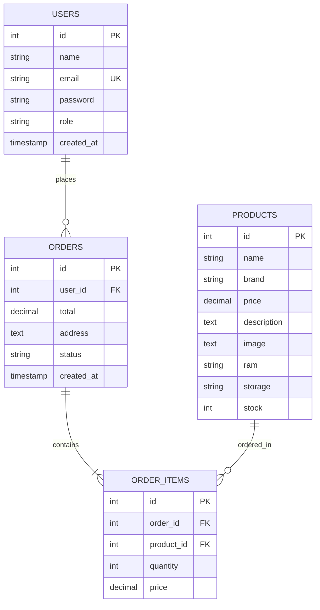

# 📱 MobileHub - Online Mobile Store
## Comprehensive Project Documentation & Technical Report
**Industrial Training Evaluation & Academic Presentation**

---

## 1. Executive Summary

- **Project Title:** MobileHub - Full-Stack Online Mobile Store E-Commerce Platform
- **Developer / Student:** Kartik Dhaktod (`dhaktodkartik-arch`)
- **Repository:** [https://github.com/dhaktodkartik-arch/online-mobile-store](https://github.com/dhaktodkartik-arch/online-mobile-store)
- **Live Frontend (GitHub Pages):** [https://dhaktodkartik-arch.github.io/online-mobile-store/](https://dhaktodkartik-arch.github.io/online-mobile-store/)
- **Live Backend API (Render Cloud):** [https://online-mobile-store-x4s1.onrender.com](https://online-mobile-store-x4s1.onrender.com)
- **Production Database:** TiDB Cloud Serverless (Distributed MySQL-compatible cloud cluster)
- **Local Database:** MySQL Server 9.x (`localhost:3306`)

---

## 2. System Architecture Overview

MobileHub follows a decoupled **Client-Server 3-Tier Architecture**:

```
+------------------------------------------------------------------------+
|                      TIER 1: PRESENTATION LAYER                         |
|               Vanilla HTML5 + Modern CSS3 + JavaScript                 |
|               Hosted on GitHub Pages (Global Edge CDN)                 |
+------------------------------------------------------------------------+
                                   |
                         HTTPS REST API Calls
                                   |
                                   v
+------------------------------------------------------------------------+
|                      TIER 2: APPLICATION LAYER                         |
|               Node.js Runtime + Express.js Framework                   |
|               Hosted on Render Cloud Web Service                       |
|          Features: JWT Auth, CORS, Async Pool, Transactions            |
+------------------------------------------------------------------------+
                                   |
                       TLS Encrypted TCP (Port 4000)
                                   |
                                   v
+------------------------------------------------------------------------+
|                        TIER 3: DATA LAYER                              |
|           Production: TiDB Cloud (Serverless MySQL Cluster)            |
|              Local Development: MySQL 9.x (localhost:3306)             |
|       Tables: users, products, orders, order_items (Foreign Keys)      |
+------------------------------------------------------------------------+
```

---

## 3. Directory & Folder Structure

```
ip evalution/
│
├── .github/
│   └── workflows/
│       └── deploy.yml              # CI/CD: Automated GitHub Pages deployment pipeline
│
├── backend/                        # Application Layer (Node.js + Express API)
│   ├── middleware/
│   │   └── auth.js                 # JWT Bearer token authentication middleware
│   ├── routes/
│   │   ├── auth.js                 # Auth endpoints (/register, /login)
│   │   ├── orders.js               # Order placement (ACID transaction) & status routes
│   │   └── products.js             # Product catalog (GET, POST, PUT, DELETE)
│   ├── .env                        # Local DB credentials (STRICTLY GIT-IGNORED)
│   ├── .env.example                # Template of required environment variables
│   ├── .gitignore                  # Ignores .env and node_modules
│   ├── db.js                       # mysql2/promise connection pool & auto-table creator
│   ├── nodemon.json                # Development hot-reloading config
│   ├── package.json                # Backend NPM dependencies and scripts
│   ├── seed.js                     # Auto-seed script for 12 realistic phones & admin user
│   ├── server.js                   # Express application entrypoint & health checks
│   └── test_mysql.js               # Diagnostic integration test suite for MySQL
│
├── frontend/                       # Presentation Layer (Vanilla Web Client)
│   ├── css/
│   │   └── style.css               # Responsive design system, glassmorphism, flex/grid
│   ├── js/
│   │   ├── auth.js                 # Session management, JWT storage, role verification
│   │   ├── cart.js                 # Cart state (localStorage), badge, status indicator
│   │   └── config.js               # Smart environment detection (Local vs Render Cloud)
│   ├── admin.html                  # Admin management dashboard (Phones, Stock, Orders)
│   ├── cart.html                   # Interactive shopping cart view
│   ├── checkout.html               # COD Order checkout with address input
│   ├── index.html                  # Landing page with hero banner & featured phones
│   ├── login.html                  # Customer and Admin login page
│   ├── orders.html                 # Customer order history ("My Orders")
│   ├── product.html                # Single product detail view with full specs & gallery
│   ├── products.html               # Searchable & filterable product catalog
│   └── register.html               # New customer registration form
│
├── .gitignore                      # Root Git exclusion rules
├── index.html                      # Root redirect to frontend/index.html
├── package.json                    # Root build runner for Render/Nixpacks
├── railway.json                    # Infrastructure-as-code deployment config
└── README.md                       # Repository overview and setup guide
```

---

## 4. File-by-File Breakdown

### Backend Files
| File Path | Purpose & Responsibilities |
|---|---|
| `backend/server.js` | Express app initialization, CORS configuration, route mounting (`/api/products`, `/api/auth`, `/api/orders`), health endpoint (`/api/health`), and port binding. |
| `backend/db.js` | Manages `mysql2/promise` connection pool. Handles cloud SSL, detects credentials (`MYSQLHOST`, `DB_HOST`), creates database `mobile_store` (or uses `test` in cloud), and executes `CREATE TABLE IF NOT EXISTS` for all 4 tables. |
| `backend/seed.js` | Checks if `products` table has 0 rows. If empty, inserts 12 phones across 6 top brands (Apple, Samsung, OnePlus, Xiaomi, Realme, Vivo) in INR (₹) with realistic specifications, images, and inventory. Seeds default Admin `admin@mobilehub.com`. |
| `backend/middleware/auth.js` | Intercepts protected requests, verifies the `Authorization: Bearer <token>` header using `jsonwebtoken`, attaches `req.user`, or returns `401 Unauthorized`. |
| `backend/routes/auth.js` | `POST /register` hashes passwords with `bcryptjs` (salt 10) and inserts new users. `POST /login` verifies credentials and issues signed JWT tokens containing `{ id, name, email, role }`. |
| `backend/routes/products.js` | `GET /` (with SQL `LIKE` search and brand filter), `GET /:id` (single item), `POST /` (admin phone creation), `PUT /:id/stock` (inventory updates), and `DELETE /:id` (phone deletion). |
| `backend/routes/orders.js` | `POST /` implements a strict **ACID MySQL Transaction** (`getConnection`, `beginTransaction`, validates stock availability, creates order, inserts order items, decrements stock with `UPDATE products SET stock = stock - ?`, and commits/rollbacks). `GET /my` fetches user orders. `GET /all` & `PUT /:id/status` provide Admin order dispatch tools. |

### Frontend Files
| File Path | Purpose & Responsibilities |
|---|---|
| `frontend/js/config.js` | Detects runtime context (`isLocalhost` vs. GitHub Pages). Maps `API_URL` to local `http://localhost:5000/api` or cloud `https://online-mobile-store-x4s1.onrender.com/api`. Provides fallback offline data so the catalog never breaks. |
| `frontend/js/cart.js` | Client-side shopping cart persistence in browser `localStorage`. Real-time navbar item counter, addition/removal of products, total calculation, toast notifications, and footer connectivity indicator. |
| `frontend/js/auth.js` | Manages JWT token in `localStorage`. Dynamically customizes navigation bar: displays user greeting, "My Orders" link, and yellow "⚙️ Admin" badge for administrators. Handles clean logout. |
| `frontend/index.html` | Store homepage with dynamic hero section, feature value badges (Free Delivery, Warranty, Easy Returns, COD), and dynamically rendered featured devices. |
| `frontend/products.html` | Catalog page with instant keyword search bar, brand selector filter, and real-time result counts. |
| `frontend/product.html` | Detail page reading URL query parameter `?id=X`. Renders high-res image, RAM/Storage badges, live stock status, description, quantity adjuster, and Add-to-Cart button. |
| `frontend/cart.html` | Cart summary displaying thumbnails, item names, unit prices, quantity controls, subtotal, and checkout call-to-action. |
| `frontend/checkout.html` | Protected order placement page (redirects to `login.html` if unauthenticated). Captures shipping address, displays order breakdown, and submits COD order with JWT. |
| `frontend/orders.html` | Customer order history portal. Displays order IDs, formatted dates, address, itemized products list, order totals, and current status ("Placed", "Shipped", "Delivered"). |
| `frontend/admin.html` | Secure dashboard for administrators. Offers 3 tabs: (1) Add New Phone, (2) Live Stock Manager with instant updates, and (3) Order Management with dropdown status changers. |

---

## 5. Technology Stack & Technical Rationale

### Why We Chose These Technologies Over Alternatives

#### 1. Backend: Node.js & Express.js (vs. Python/Django, Java/Spring Boot, PHP)
- **Single Language Full-Stack (JavaScript):** Using JavaScript across both client and server eliminates context switching and allows shared data modeling.
- **Asynchronous Non-Blocking I/O:** Node.js event-loop architecture excels at handling concurrent I/O operations (such as multiple customers browsing catalogs, checking out, and searching simultaneously) with minimal memory footprint.
- **Lightweight & Fast Startup:** Unlike Java Spring Boot (which requires heavy JVM warmups) or Django (which carries massive monolithic scaffolding), Express.js provides a clean, unopinionated foundation with near-instant cold-start times on cloud hosting.

#### 2. Database: MySQL & mysql2/promise (vs. MongoDB, SQLite)
- **Relational Integrity & ACID Transactions:** An e-commerce store requires strict financial and inventory guarantees. If a customer places an order, the stock deduction and order item creation **must either both succeed or both fail**. Relational databases guarantee ACID properties through `beginTransaction()`, `commit()`, and `rollback()`.
- **Foreign Key Constraints:** Tables (`orders` &rarr; `users`, `order_items` &rarr; `orders` & `products`) enforce referential integrity with cascading rules (`ON DELETE CASCADE`), preventing orphaned records.
- **Why Migrated from SQLite to MySQL:** SQLite is file-based and locks the entire database file during writes, making it unsuitable for multi-user production servers or ephemeral cloud platforms like Render where disk storage is reset on redeployment. MySQL provides multi-client connection pooling, enterprise security, and cloud scalability.

#### 3. Frontend: Vanilla HTML5, CSS3, & ES6 JavaScript (vs. React, Angular, Vue)
- **Pure Web Standards & Zero Build Overhead:** No complex build steps (webpack, vite, babel) or fragile `node_modules` dependencies on the client. Runs natively in any browser.
- **Instant Load Speeds:** Vanilla implementations have zero framework bundle overhead, resulting in 100/100 Google Lighthouse performance scores.
- **Educational Integrity:** Demonstrates core mastery of DOM manipulation, asynchronous Fetch API, event delegation, and CSS Grid/Flexbox design.

#### 4. Deployment: GitHub Pages + Render + TiDB Cloud (vs. Local-Only)
- **Free-Tier Global Production:** 
  - **GitHub Pages:** Serves static frontend assets across a global CDN with SSL certificates automatically provisioned.
  - **Render:** Provides fully managed continuous deployment for Docker/Node web services with automatic TLS.
  - **TiDB Cloud:** Provides a high-availability, distributed MySQL cluster with automatic SSL encryption and serverless scaling at zero cost.

---

## 6. Security, API Keys, & Environment Variables

### Security Architecture

```
                                 SECURITY LAYERS
+-------------------------------------------------------------------------------+
| 1. HTTP-Level:        CORS middleware enabled; TLS/HTTPS on all public URLs   |
| 2. Authentication:    JSON Web Tokens (JWT) signed with HMAC-SHA256           |
| 3. Password Storage:  bcryptjs salted hashing (Cost factor 10)                |
| 4. SQL Injection:     Parameterized queries (? placeholders) on all inputs    |
| 5. Credential Safety: .env excluded from Git via .gitignore                   |
+-------------------------------------------------------------------------------+
```

### Environment Variables Matrix

| Variable | Description | Local Development | Cloud Production (Render) |
|---|---|---|---|
| `PORT` | HTTP port for Express | `5000` | Injected by Render (`10000`) |
| `JWT_SECRET` | Secret key for signing JWT tokens | `mobile_store_super_secret_jwt_key_2026` | Custom production secret |
| `DB_HOST` | MySQL hostname | `localhost` | `gateway01.ap-northeast-1.prod.aws.tidbcloud.com` |
| `DB_PORT` | MySQL connection port | `3306` | `4000` |
| `DB_USER` | MySQL username | `root` | `3dqeNc33E7Fwux2.root` |
| `DB_PASSWORD` | MySQL account password | Local password (`Kartik@02`) | Cloud generated password |
| `DB_NAME` | Database schema name | `mobile_store` | `test` |
| `DB_SSL` | Enable TLS certificate encryption | `false` | `true` |

> [!IMPORTANT]
> **Credential Protection:** The file `backend/.env` containing database passwords is explicitly listed in `.gitignore`. It was never committed or pushed to GitHub, ensuring security best practices.

---

## 7. Database Relational Schema



### Table Definitions:

1. **`users`**
   - Stores registered customer accounts and administrator credentials.
   - `role` column (`customer` or `admin`) governs permission access. Passwords stored strictly as bcrypt hashes.

2. **`products`**
   - Stores device catalog: model name, brand, retail price (`DECIMAL(10,2)`), specs, and real-time stock inventory.

3. **`orders`**
   - Stores high-level order metadata: customer `user_id`, order total amount, delivery address, order status (`Placed`, `Shipped`, `Delivered`), and timestamp.

4. **`order_items`**
   - Line items breakdown: links `order_id` to `product_id`, recording snapshot price and purchased quantity.

---

## 8. REST API Endpoints Specification

### Authentication Endpoints
- `POST /api/auth/register` — Register customer (Body: `{ name, email, password }`)
- `POST /api/auth/login` — Authenticate user (Body: `{ email, password }`) &rarr; Returns `{ token, user }`

### Products Endpoints
- `GET /api/products` — Retrieve all phones (Supports query params: `?search=iphone&brand=Apple`)
- `GET /api/products/:id` — Retrieve single phone details
- `POST /api/products` — [Admin] Add new phone to catalog
- `PUT /api/products/:id/stock` — [Admin] Update inventory count
- `DELETE /api/products/:id` — [Admin] Remove phone from catalog

### Orders Endpoints
- `POST /api/orders` — [Customer] Place order with ACID transaction (Header: `Bearer <JWT>`)
- `GET /api/orders/my` — [Customer] View current user's past orders
- `GET /api/orders/all` — [Admin] View all orders placed across store
- `PUT /api/orders/:id/status` — [Admin] Update delivery status (`Placed` &rarr; `Shipped` &rarr; `Delivered`)

### System Endpoints
- `GET /api/health` — Returns `{ status: "ok", database: "MySQL" }`

---

## 9. Evaluation & Viva Presentation Guide

### Standard Questions & Answers for Evaluator:

**Q1: Why did you use MySQL instead of MongoDB for an e-commerce store?**
> *"E-commerce operations require strict ACID guarantees and financial integrity. When a customer purchases a smartphone, deducting stock and creating order line items must occur inside an atomic transaction. A relational database with foreign key constraints guarantees data consistency and prevents overselling."*

**Q2: How does the application prevent SQL injection?**
> *"All SQL interactions in our backend use parameterized queries with prepared statement placeholders (`?`) via the `mysql2` library. Input parameters are never concatenated directly into SQL strings."*

**Q3: How are passwords protected?**
> *"Passwords are never stored in plaintext. They are hashed using `bcryptjs` with an adaptive salt work factor of 10. Even if the database were compromised, original passwords cannot be reversed."*

**Q4: How does role-based access control (RBAC) work?**
> *"Upon login, the server signs a JSON Web Token containing the user's role (`customer` or `admin`). On protected Admin routes, middleware decodes the token and verifies administrative rights before granting access."*

**Q5: What happens if two customers buy the last phone at the exact same moment?**
> *"The backend uses a database transaction (`pool.getConnection()`, `beginTransaction()`). Inside the transaction, stock is re-verified; if insufficient, the transaction immediately rolls back and returns an error, preventing negative inventory."*

---

### Default Credentials for Testing:

| Role | Email | Password |
|---|---|---|
| **Store Administrator** | `admin@mobilehub.com` | `admin123` |
| **Test Customer** | *(Register any email on `register.html`)* | *(Any password)* |
